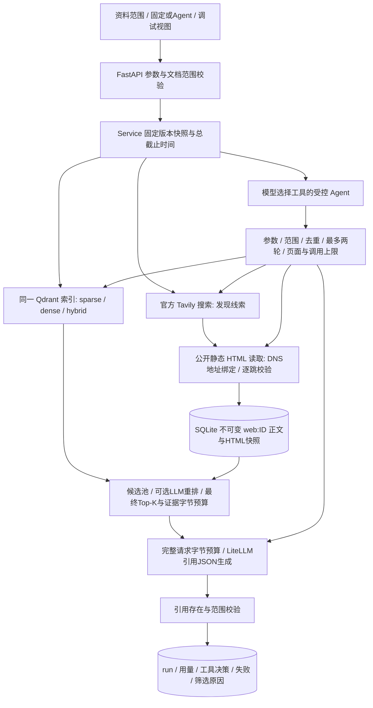

# 文档 RAG 与在线证据架构

## 文档与索引契约

原文件、内容版本、重建尝试的索引代次分别保存。解析子进程限制60秒；解析后才开始后台模型预算。embedding成功批次进入 `processing_checkpoints(generation, operation, key, body)`，key含输入文本、完整索引指纹及document/query角色；失败重试重新解析后复用匹配批次。切换配置不会复用旧契约向量。

索引指纹包含解析器、chunk策略/size/overlap、稀疏算法、模式、embedding模型/revision/维度/endpoint、输入profile和双方prefix。新指纹使用新collection。成功upsert后才切换活动代次；失败保留此前活动索引。旧chunks、原文件和历史runs保持可读，不自动删除或改写ID。检索参数变化不需重建，进入policy/cache namespace。

embedding document/query分别调用对应供应商输入角色。返回模型名（若提供）、完整批次index、维度、有限非零数值必须匹配。未知供应商要求显式profile。`EMBEDDING_REVISION`是部署者声明，无法仅凭兼容API证明供应商未替换同名模型；真实验收仍需核对提供商版本与输入说明。

## 检索与预算

sparse/dense只执行对应分支，hybrid使用两路；同索引同作用域，离线dense明确不可用。RRF常数、每路limit、融合候选池与最终Top-K分开。重排接收完整候选池并验证排列，之后才选最终证据。在线候选按本地/网页交替进入有界pool，记录候选ID；这只是确定性基线，不宣称最优来源配额。

重排保留全部候选ID，长正文按完整请求预算分配可追踪的摘录；Agent规划输入使用相同容量控制。补充本地检索按独立轮次分支重新RRF，规划和最终回答共用候选池，避免新增证据因追加顺序被排除。网页按发现顺序排列，不依赖并发读取完成顺序。融合前后的候选、池大小淘汰和最终上下文舍弃原因分别记录。

`EVIDENCE_BUDGET_BYTES`计量实际送入生成的证据JSON UTF-8字节。逐条记录完整选中、字节摘录、最小摘录超限、最终Top-K舍弃和源字符offset。`MODEL_REQUEST_BUDGET_BYTES`另外检查完整messages JSON加 `max_tokens×8` 输出预留；不包含HTTP封装，不是供应商精确tokenizer。超限在模型调用前失败，保留证据和审计记录。

交互为40次/60秒，后台为5000次/1800秒，单模型调用最多60秒。retry也计一次，generation可用备用模型，embedding不换模型。后台成功图谱块和摘要块保存检查点；partial结果可手动重新构建，正文引用保留。评测另有全实验model/judge/search计数器；次数预算不能替代账户上的货币支出上限。

## 网页发现、读取和引用

搜索返回的title/snippet仅用作发现。官方API固定HTTPS地址、basic、禁止自动升级搜索深度、最多5结果/次（可配1–10）；429/余额限制/超时不自动重复付费调用。读取仅处理HTTP/HTTPS标准端口的公开静态HTML，每页默认1MB、30,000正文字符、10秒、3跳、并发3、每问最多6页。拒绝压缩响应以避免展开资源失控，不执行JS、不获取图片/外链/iframe。

每次跳转重新做URL语法与全部DNS地址校验；拒绝内网、回环、链路本地、共享地址、云元数据、组播、映射或转换IPv6等。socket连接固定已校验地址，TLS保留原主机SNI和证书验证，无环境代理、无二次hostname解析。DNS等待受异步截止时间限制；取消后底层OS resolver线程可能暂未退出，它不会读取或写入网页证据。socket读使用剩余总时间，取消后先排空有界IO再释放作用域。

`web_evidence`保存唯一 `web:ID`、原/最终URL、title、UTC获取时间、可用的页面发布时间（标记未独立核验）、原HTML快照、正文快照与hash、截断状态。按ID只插入；回放同ID仅允许完全相同内容。每个run冻结最终证据摘录，不重新抓取旧引用。`/api/evidence/{web:ID}`和本地chunk使用统一入口。当前网页链接可能变化，快照页用于核对历史回答。

读取失败展示 `body_unavailable` 和未经核对的搜索摘要，摘要不进入生成证据。已有本地或成功读取的网页证据继续使用。回答提示保留时间、版本、口径冲突，不能默认网页正确。程序引用校验只证明ID存在且在本次上下文，不证明事实正确或文本蕴含。

HTTP读取核对Content-Length完整性及最终截止时间。全局问答超时仍保存已经取得的有界证据，明确标记request_timeout；不把超时改称成功回答。缓存命中的本次调用和源回答调用分别审计。

## 固定流程与受控 Agent

固定基线保留“文档检索 / 搜索 → 读取 → 重排筛选 → 回答”。Agent先看已取得的文档检索中间结果（web范围可为空），由LLM通过结构化JSON选择 `retrieve_local/search_web/read_page/answer/stop`。没有用关键词路由冒充模型决策。

程序构造允许动作，拒绝额外args、任意document_id、范围外本地读取、未发现网址、重复查询与重复读取。local/web工具数量由范围限制。额外search/retrieve最多两轮，read最多6页，决策最多9次，并共享问答时间与模型预算。action与args、验证状态、工具结果状态和耗时记录到run。模型stop保留证据并停止生成；模型错误/控制器拒绝按已有证据降级回答并明确标记。未配置模型时Agent返回409。

## 评测与边界

普通pytest阻止外部DNS/socket，模型/搜索/页面替身明确命名。文档评测使用单个临时索引旁路缓存；网络比较使用同一冻结快照，未记录查询明确replay miss。live API检查单独运行，不与冻结实验混算。人工表、RAGAS、引用语义支持、任务完成情况允许null/pending，不能把锚点指标或合成judge契约当效果评分。

保留单用户本机、串行锁、无认证/多租户/OS内存配额的边界。正文清洗是启发式，非完整浏览器；动态站点、验证码、登录、PDF不支持。网页快照独立于导入文档保留，目前无自动过期或网页删除UI；删除导入文档会删除其文档引用，但不删除原网页快照。原HTML从API返回为JSON字符串，只通过textContent展示，不在应用源执行。
