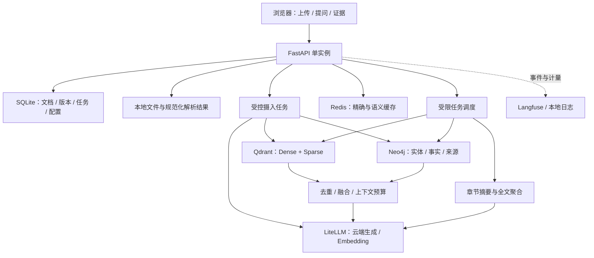

# 复杂文档分析 Agent：完整方案审查与实施基线

审查日期：2026-10-08（Asia/Shanghai）。

状态更新（2026-10-09）：M1 收尾及 M2–M5 已连续实施，当前验证和能力边界见 PROGRESS.md / DELIVERY.md。本文保留原始设计基线；审查时目录为空的描述及服务核查属于历史状态，不能替代实际实现/账户验收记录。

用户于 2026-10-09 授权连续完成 M1 收尾及 M2–M5。阶段自检、测试和进度记录通过后自动继续；本文历史停止要求均已取消。缺少凭据只阻塞真实服务验收，不阻塞独立实现。

## 1. 总体判断和取舍

项目可行。核心价值是：针对复杂长文档，用可追溯的原文证据回答问题，比较混合检索、多轮检索和图谱检索的质量与代价，并展示失败时的可控行为。

采用单实例模块化 Python 应用，FastAPI 同时提供 API 和简单静态页面。SQLite 保存应用状态，文件目录保存原始文件与规范化解析结果。模型走云端，通过进程内 LiteLLM 统一调用；向量、图谱、缓存和观测优先使用托管服务。

定位为可向生产演进的企业文档场景 MVP。免费层、单实例、无完整认证的版本不能称为已满足企业生产要求。

默认独立问题，不依赖聊天历史；提供普通问答、关系分析、全文洞察三类操作。跨文档关联在 M2 核心验收后按样例价值决定是否扩展，不作为交付阻塞项。公共联网搜索、多 Agent、OCR、复杂版式重建、完整多租户、分布式队列、高可用不列入本轮必做。

## 2. 对前几版规划的纠正

1. 不应每次审查只增加模块；判断问题的影响和验证方式比增加功能更重要。
2. “先找纯向量注定失败的问题”不成立。先标注原文证据，再验证具体基线是否遗漏。
3. 不应把跨文档实体融合直接变成 M2 必做。跨章节就能验证核心机制，跨文档还引入消歧与口径冲突。
4. 全局章节摘要与图谱社区摘要是不同技术；实现前者不能宣称已实现后者。
5. 文档版本之外还需要索引代次和检索语料快照。改变分词、embedding 或 IDF 统计会影响答案与缓存。
6. 图谱失败不必阻止已经可用的混合检索；应分别记录解析、向量、图谱和摘要的就绪状态。
7. Upstash 不能被简单描述为“不支持向量检索”。现有官方兼容文档列出 VECTOR.* 扩展，但不能直接套用 RediSearch FT.* 的接口。
8. LiteLLM 冷却与降级不应未经验证就被称为完整的关闭/打开/半开熔断状态机。
9. 后台任务状态落库不等于任务可自动恢复；必须定义重启后的行为。
10. UI 只展示执行步骤、证据和路径，不把模型内部思维过程作为产品能力。

## 3. 官方能力核查

| 服务 | 核查结果 | 设计影响 |
| --- | --- | --- |
| Qdrant Cloud | 免费实例为单节点，1 GB RAM、0.5 vCPU、4 GB 磁盘；闲置一周暂停，未重新激活持续闲置四周删除 | 小规模演示可选；不能承诺生产可用性，演示前需预检，索引必须可重建 |
| Neo4j AuraDB Free | 官方免费介绍列出 50,000 节点、175,000 关系；72 小时闲置会暂停，暂停超过 30 天可被删除 | 限制抽取规模；保存规范化抽取结果供重建，不依赖实例永久在线 |
| Upstash Redis | 定价页列出免费 256 MB、月 500K 命令、10 GB 带宽；兼容文档列出 VECTOR.*，SEARCH.* 与 RediSearch FT.* 不兼容 | 不能照搬 Redis Stack 示例；具体免费实例、命令、SDK 支持必须做小样验证 |
| Langfuse Cloud | Hobby 有 50K units/月、30 天数据访问窗口；units 不是问答次数 | 控制观测粒度；评测原始记录与报告另存本地，不能只留云端链接 |

来源：[Qdrant 免费集群](https://qdrant.tech/documentation/cloud/create-cluster/)、[Aura 免费规模](https://neo4j.com/free-graph-database/)、[Aura 暂停规则](https://neo4j.com/docs/aura/managing-instances/instance-actions/)、[Upstash 定价](https://upstash.com/pricing/redis)、[Upstash 兼容性](https://upstash.com/docs/redis/overall/compatibility)、[Langfuse 定价](https://langfuse.com/pricing)、[Langfuse 数据访问与保留](https://langfuse.com/docs/administration/data-retention)。

以上信息仅代表本次查阅的公开资料，不代表已经验证用户账户的实际配置。Upstash 向量命令详情页本次返回 503，不能据此判定产品不支持；将账户级验证保留为 M3 技术验证项。

模型生成、embedding、rerank、图谱抽取和 RAGAS 评分可能产生费用。“三分钟启动”限定为依赖已准备且凭据已配置后的启动，或使用离线演示；账号注册和云资源创建不计入承诺。

## 4. 运行架构与降级

建议区分三种模式：

- 完整云端模式：真实模型与托管服务。
- 本地存储加云端模型：可用 Qdrant 客户端本地模式、本地证据图和内存缓存，减少开发时必配账号数量；仍有真实 embedding 和生成。
- 完全离线演示：解析、词项检索、原文摘录及明确标注的预置图谱/回答回放。没有真实 dense embedding 与 LLM 生成，不参与效果结论。

Qdrant 客户端提供无需启动 Qdrant 服务的本地实现，但不能用它推断云端索引性能或全部接口完全一致：[官方实现](https://github.com/qdrant/qdrant-client/blob/master/qdrant_client/local/qdrant_local.py)。

云端模式发生服务故障时，不能自动返回预置答案冒充成功。Redis 故障跳过缓存，图谱故障退到混合检索并标记，观测故障写本地日志，生成全部失败则返回证据和明确失败状态。未配置服务与配置错误应分开诊断。

## 5. 数据契约、版本与生命周期

最小实体：Document、DocumentVersion、ParseBlock、Chunk、IngestionJob、IndexGeneration、GraphFact、QueryRun。无需先建通用平台，也不必给每个数据对象单独引入框架。

来源位置必须允许不同形态：PDF 物理页与印刷页标签、标题路径、DOCX 段落/表格、幻灯片号、工作表和行范围、文本行号。一段内容可以对应多个来源位置。

必须区分：

- 内容版本：原文件发生变化。
- 索引代次：内容不变，但解析器、chunker、embedding、稀疏编码或图抽取配置变化。
- 检索快照：参与检索的文档版本、索引代次和必要的语料统计范围。

问答开始时固定快照。向量、图谱、缓存、摘要及引用读取同一快照。每个检索分支都必须带范围限制；图路径的中间节点和关系证据也不能越过所选范围。仅过滤最终答案不够。

状态拆成 parse_status、vector_status、graph_status、summary_status。向量可用而图谱失败时仍可混合问答；不能把部分图谱当作完整图谱。原文件更新只有在目标必需能力就绪后才切换对应可用版本。

上传后返回任务 ID。单实例限制任务并发，重 CPU 的解析离开事件循环，网络调用采用异步和超时。任务阶段和失败原因落库，重启后将中断任务标记为可重试；稳定 ID 和幂等写入防止重复数据。起步不做复杂断点续跑。

删除先屏蔽新请求，再清理 Qdrant、图谱证据、缓存、摘要、文件。清理失败可重试。MVP 默认保留旧版本直至显式清理；删除后旧引用显示已删除，不跳转到新版本。跨文档共享实体不能随着一篇文档被误删。

保存可重放的规范化解析结果和经过校验的图抽取结果，以支持免费实例丢失后的重建；解析与图抽取缓存也需要版本与删除策略。

## 6. 解析、切分与输入质量

建立统一 ParseBlock，再进行章节和 chunk 切分。标题无法可靠识别时明确降级到段落/长度切分，不生成虚构标题。保留原始文本与检索用规范化文本，避免单位、负号、小数点或年份在清洗中消失。

| 格式 | 应实现的行为 | 不可默认承诺 |
| --- | --- | --- |
| PDF | 文本、页码、可识别表格；识别疑似扫描/混合页面；记录抽取覆盖 | 扫描 OCR、多栏完美阅读顺序、图表数值恢复 |
| Markdown | 保留标题层级、列表、代码块、表格 | 用简单正则可靠解析所有 Markdown |
| TXT | 编码识别或显式失败、段落和行位置 | 任意乱码文件都可恢复 |
| CSV | 使用成熟解析库，保留表头、行号、引用字段与引号规则 | 用 split(',') 解析所有 CSV |
| DOCX | 正文顺序、标题、段落和表格 | 没有排版引擎时提供可靠页码 |
| PPTX | 幻灯片号、文本和表格，说明备注是否纳入 | 自动读取图片文字、SmartArt 和所有嵌入对象 |
| XLSX/XLS | 明确各格式解析引擎，工作表、行范围、表头和公式缓存值 | 默认执行公式、宏或自动恢复复杂合并表头 |
| HTML | 清理脚本、样式和导航噪声，保留正文标题和表格 | 只去标签就一定获得干净正文；自动访问外部资源 |

长表格按行分块并重复必要表头、单位和工作表信息。普通段落按章节优先、长度兜底，结合所选模型限制计算预算；重叠只用于需要的位置，避免全文大量重复。

M1 使用 PDF、Markdown、TXT、CSV，CSV 提供结构化数据的早期验证。M5 补其余格式，保证各适配器复用摄入链路。疑似扫描或抽取质量过低时提示部分可检索或拒绝入库，不能静默宣称全文已索引。

## 7. Dense、Sparse 与融合排序

Dense 需在 M1 验证真实云端 embedding 的中文质量、批量输入、维度、长度和返回契约。生成模型可用不等于 embedding 可用。持久化 provider/model/revision、维度、归一化和距离度量。禁止向现有索引混入不兼容模型向量，包括维度相同的不同模型。

Sparse 优先无神经模型推理的 BM25 路线，使用成熟编码能力与中文分词，验证缩写、代码、数值、公司名及单位。普通统计计算不等于本地模型推理。具体编码器与 Qdrant 版本在 M1 小样验证后锁定；不能把未经定义的词频或哈希方案直接称为 BM25。

Qdrant 官方支持 BM25 稀疏表示及 IDF modifier。若服务端计算 IDF，客户端不能重复乘同一 IDF。词项维度、词频权重和查询处理必须兼容。官方资料说明默认 IDF 统计范围是被查询分片的数据，过滤某份文档不必然让 IDF 只基于该文档；评测应冻结语料与索引快照，或验证所用版本的统计范围能力。[官方全文检索](https://qdrant.tech/documentation/search/text-search/full-text-search/)

Dense 与 sparse 先独立召回，再 RRF。记录每路候选数、原始分数、原始排名、融合排名；RRF 不是置信度，不能直接给“答案可信度 95%”。图谱召回映射回 chunk 后统一去重。需要规定图谱候选排序依据，不能把无序路径结果直接交给 RRF。

优先使用一次可解释的融合，避免多次嵌套 RRF 无意改变各路权重。原问题与改写检索视为同一检索家族，限制扩展数量，防止通过复制查询重复投票。Reranker 只能排序已召回候选，不能恢复从未召回的证据。[Qdrant 混合检索](https://qdrant.tech/documentation/search-tuning/hybrid-search/)

上下文选择按 token 预算、覆盖度和去重组织。相邻原文扩展要记录来源与额外预算。数字类答案优先引用原数值；涉及计算时仅允许受控四则运算，展示公式、操作数、单位和来源，无法对齐口径时不计算。

## 8. GraphRAG 和受限 Agent

选一个真实领域建立小 schema。实体名称不能直接作为唯一身份；保留别名、类别、范围和归一化依据。LLM 不确定的实体合并保守处理，避免把两家公司或不同产品合并。

财务事实不能只存“公司—收入—100 亿”。至少包含主体、指标、数值、单位、期间、口径、来源与断言性质（历史事实/预测/作者观点）。建议有来源的事实记录/节点与实体关系配合使用，同一事实可有多个证据，冲突事实并存。

抽取采用结构化输出、校验、有限修复和失败计数。校验不通过的结果不写入。保存抽取模型和提示词版本；抽取模型自报置信度仅作诊断，不能当作准确概率。

查询使用受控、参数化 Cypher，不让模型执行任意数据库语句。默认有限跳数，同时限制起点数、单节点扩展、关系类型、路径数、查询超时与证据 token；两跳也可能爆炸。每条路径的每一步都需要允许范围内的来源证据。

最终答案回到原文。共现不能转成业务关系，相关关系不能自动转成因果，多个真实边组合也不能自动产生真实结论。

Agent 路由为普通问答、关系分析、全文摘要，默认最多一轮补检索，受统一调用与时间预算限制。路由失败退回普通问答，实验可强制指定路线以排除调度器干扰。单次调用图检索工具的“工具步数”与图内的“关系跳数”分开记录。

M2 的证据卡包含问题、答案、最小必要证据组、替代有效证据、章节位置、关系路径和基线实际遗漏。不要求图谱获胜。

## 9. 全局洞察

全文洞察遍历章节，不依赖一次 top-k 检索。章节摘要保留原文 chunk 引用，聚合时继承与核验原始来源；章节摘要本身不取代原始证据。

输出核心观点、风险点、关键数据，同时展示覆盖章节数、遗漏章节和失败原因。遗漏章节时标注部分摘要。风险应区分原文明示与基于证据的分析推断。

数据保留对象、时间、单位、币种、口径、预测属性，避免重复出现的数据被重复计数，不把不同口径数据直接相加。中间摘要按内容与配置版本复用，减少长文档反复付费。

## 10. 缓存与模型可靠性

缓存查找顺序为：固定请求范围和快照 → 精确缓存 → 问题 embedding → 语义候选 → 关键条件校验 → 未命中则执行问答。问题 embedding 尽量在缓存与检索中复用。

缓存命名空间包括模式、文档版本、索引/语料快照、生成策略、提示词、检索与图配置、embedding 版本。单用户 MVP 不虚构已实现租户权限；未来接入认证后再绑定服务端身份。

重要的新约束：文档不变但图谱构建完成、索引更新或语料 IDF 改变，旧缓存也可能过时。用快照或能力版本隔离。降级生成的答案不进入正常答案缓存，或使用明确独立的降级命名空间。

相似度不是语义等价。阈值通过可复用问法和年份/实体/否定/比较方向等困难负例校准；信息缺失时宁可不命中。报告命中覆盖、命中准确性、错误接受数量、样本量及净延迟/成本收益，不保证零误命中。

MVP 可用 Redis 保存有上限的候选向量并在应用中计算余弦，作为稳定兼容的实现；原生向量命令通过账户级验证后可替换。这是规模取舍，不是声称 Redis 没有向量能力。候选按作用域索引、限制数量、批量读取，不能每次扫描整个 Redis。TTL、索引成员清理和文档删除必须协同。并发重复请求使用单实例合并机制即可。

默认只保留一套应用答案缓存；LiteLLM 自带响应缓存先关闭，避免两层缓存难以解释。缓存命中仍创建本次 trace，记录来源回答、相似度及当前实际消耗，不能复用旧耗时冒充本次耗时。

LiteLLM Router 提供重试、降级和冷却。项目明确一个重试责任层，限制总调用数与全请求截止时间，并测试取消后的任务收尾。认证、无效模型和错误参数不做无意义重试；限流与服务异常遵守受限策略。不要仅凭 cooldown 宣称已验证半开探测行为。[LiteLLM Router](https://docs.litellm.ai/docs/routing)

备用模型需验证上下文、结构化输出、参数、语言与凭据。embedding 不支持无条件跨模型降级；可明确退到 sparse-only 并标注，或报告暂时不可用。备用模型来自同一 provider/额度池时不能宣称可抵御整家服务故障。

## 11. 可观测、评测与实验有效性

M1 定义结构化事件与 request/run ID，M4 接 Langfuse。追踪摄入、抽取、摘要、检索、融合、生成、缓存与评测。观测发送失败不能阻断回答，异步任务显式传递 trace 上下文，退出时尽力 flush。LiteLLM 回调与手动 span 避免重复计费记录。

保存每路排名、原始分数、过滤范围、选中/丢弃原因、模型、token、重试、耗时和失败。没有供应商用量时标注估算或未知；成本表有日期。缓存答案生成成本与本次命中成本分开。评分是离线标签或显式 judge 的结果，不把每个生产问题自动称为已经有真实质量分。

黄金集建议起步 30 题：8 个局部事实、6 个词项/别名、8 个跨章节关系、4 个表格/数值口径、4 个证据不足/冲突。另设少量全文摘要检查表。人工核对答案与证据；按语义问题簇分开发集与保留集，避免同义改写泄漏。数量是初始回归规模，不代表统计充分性。

M1 开始积累题目，M2 建 3–5 张机制证据卡，M4 完整运行。允许替代正确证据组，并保留稳定的原文位置，避免改变 chunk 大小后把等价证据判错。

对照采用相同文档快照、chunker、embedding、生成模型、提示词和最终上下文预算，先固定路由比较纯 dense、混合、多轮混合、混合加图谱，再单独评估自动路由。评测默认旁路答案缓存。Rerank 对比固定候选集；图谱的离线抽取成本单列，不能只报查询价格。必要时在短文档上加全文上下文基线，确认检索架构确实必要。

同时记录候选证据召回、最终上下文证据召回和“全部必要证据同时到齐”的比例。候选池召回很高但最终输入缺证据，依然无法完成多跳回答。定位失败为解析、召回、融合、上下文选择、图抽取、路由、生成或评分问题。

RAGAS 三项：faithfulness 检查回答与上下文支持关系；answer/response relevancy 涉及问题与回答相关性，官方实现使用 LLM 和 embedding；LLM context recall 依据参考答案中的主张覆盖，不等同于文档 Recall@K。参考：[faithfulness](https://docs.ragas.io/en/stable/concepts/metrics/available_metrics/faithfulness/)、[relevancy](https://docs.ragas.io/en/stable/concepts/metrics/available_metrics/answer_relevance/)、[context recall](https://docs.ragas.io/en/stable/concepts/metrics/available_metrics/context_recall/)。

不同指标依赖与 API 版本需锁定；所有 judge 与评估 embedding 也接入统一调用层，防止隐式要求额外默认 provider key。缺配置或打分失败保留状态，不能写成 0、1 或静默剔除。拒答题单独评估，不能因正确拒答在相关性指标上表现低而误判。用人工样例核对中文 judge 的一致性。

报告包含每题输入、上下文、回答、评分、错误、预算、配置及来源快照。少量重复运行可估计模型波动；小样本下不作显著性或可靠 p95 保证。Rerank 要称为模型对比，必须实际跑两个模型；只接一个模型只能称为有/无 rerank 对照。

## 12. 安全、隐私和交付约束

文档是数据，不能改变工具权限或运行配置。工具只读指定范围，上传内容不能触发任意命令、Python/Cypher、外链访问或文件读取。单元样例包含文档内提示注入。

上传限制同时考虑压缩文件大小、解压后大小、页/行/工作表数量和解析耗时；不执行 Office 宏、公式或 HTML 脚本。文件路径由服务端生成，引用访问按记录解析。UI 对文档、文件名和模型内容安全渲染，避免存储型脚本执行。

默认绑定本机地址、无任意跨域，公共部署之前补认证与访问控制。所有凭据只来自环境变量；.env、上传文件、运行数据库和敏感 trace 不入 Git。健康检查不返回密钥。正式文档说明每家云服务接收哪些数据；离线演示模式不发出模型、云存储或遥测请求。

CI 无 key、无云端计费，测试核心逻辑和接口契约。云端 smoke test 显式运行在隔离的测试前缀/命名空间，覆盖写入、读取、过滤和清理。测试失败不能清理用户索引。

基础依赖与评测依赖分组，核心仍保持 pip install -r requirements.txt 可启动。确定一套实测 Python 版本，在 Windows 本机及 Linux CI 验证；不需要 Node 构建工具、Docker、GPU 或本地神经模型。依赖锁定与 README 安装命令同步。

## 13. 最终里程碑和验收

### M1：可追溯的混合问答

- 启动配置、单实例 FastAPI、静态 UI、SQLite/文件目录、任务状态、版本与索引契约。
- PDF、MD、TXT、CSV 统一解析；章节/长度切分；表头与来源保留。
- 真实云端 embedding、LiteLLM 基础生成、Qdrant dense+sparse、RRF、引用检查、拒答。
- 显式离线演示和本地存储适配；结构化事件、基础题集、README、单元测试与 CI。
- 前置小样验证：中文 sparse、embedding 批量/维度、Qdrant 过滤/融合；失败即调整具体实现，不拖到后期。
- 验收：真实上传至回答闭环，来源可定位；重复上传幂等，范围过滤与删除有效，失败任务可识别和重试。

### M2：图谱增益与全文洞察

- 先完成 3–5 张证据卡及 M1 基线；没有真实遗漏也如实记录。
- 小 schema、别名与事实建模、结构化抽取、Neo4j 写入、逐跳证据范围与版本控制。
- 受限图检索、与混合召回融合、任务路由和一轮补检索。
- 章节摘要与全文聚合，关键数据口径、引用及覆盖状态。
- 四组基础对照及失败归因。跨文档扩展只在已有样例证明价值时追加，不拖延核心交付。
- 验收：关系可追溯、图谱不可用可降级、摘要覆盖可说明、实验可复现；图谱效果提升不是硬性退出条件。

### M3：成本与可靠性

- 精确/语义缓存、候选范围与容量上限、困难负例校准、版本与能力失效。
- LiteLLM 路由、重试与冷却、备用模型、预算和故障行为；验证实际恢复机制。
- 文档/索引变化、缓存故障、模型故障和并发重复问题的测试。
- 验收：报告缓存误命中与净收益；明确备用模型真实配置和已验证能力。没有第二个可用模型时，只能完成故障逻辑测试，不能声称真实多供应商切换已验收。

### M4：观测与评测报告

- Langfuse 全链路追踪及本地持久化结果。
- 至少 30 条人工核对问答、开发/保留划分、RAGAS 三项及证据/引用指标。
- 参数实验、rerank 可插拔与实际对照；问答和全文摘要分开评估。
- 验收：固定快照重跑，记录失败及缺失评分，成本/延迟可解释；云端观测可查看，报告不依赖云端历史永存。

### M5：格式覆盖与可复现交付

- DOCX、HTML、PPTX、XLSX/XLS 适配；每类正常、边界、拒绝样例；验证引用和下游摄入契约。
- 全新环境安装、演示预检、重建命令、服务与数据边界说明。
- README 架构、启动、选型、缓存阈值、模型失败策略、对照结果和已知限制。
- 可公开样例、演示讲解、结果材料。Docker Compose 最后按需要补充。
- 验收：他人可按文档复现，全部必做格式有证据，功能描述和真实能力一致。

M4 的报告需明确当时验证过的格式；M5 新增格式后运行对应解析/引用与端到端 smoke test，不沿用旧报告宣称所有格式已评测。若统一链路被改动，再重跑受影响的回归集。

每个里程碑交付运行方式、验证记录、已知限制、下一阶段范围，然后自动进入下一阶段。没有 key 时继续完成可独立验证的工作，但真实云端验收标记为待验证。

## 14. 实施前尚需验证的事项

| 事项 | 最迟阶段 | 验证方式 |
| --- | --- | --- |
| 主生成和 embedding 的真实提供方、兼容性与费用 | M1 开始 | 最小调用、中文样例、批量与维度检查 |
| 中文 sparse 编码与 Qdrant 版本契约 | M1 开始 | 小语料命中、IDF 和过滤测试 |
| 公开文档是否有足够关联证据 | M1 选材、M2 证据卡 | 人工核对原文，不预设基线失败 |
| 免费账户连接、休眠和实际限额 | 各服务首次接入 | 账户级预检和隔离 smoke test |
| 缓存原生向量命令是否适合目标账户 | M3 | 小规模写查删、SDK/REST 兼容；不通过则有界应用比较 |
| 备用模型是否独立、兼容且可调用 | M3 | 真实调用与故障注入分别验证 |
| RAGAS、LiteLLM、Langfuse 选定版本是否协同 | M4 前，基础接口 M1 留出 | 一条端到端评分/trace 样例，再扩大全集 |

这些是验证任务，不是要求用户提前决定几十个技术参数。除凭据、预算和私有资料等必须由用户提供的信息外，常规实现选择由开发过程根据证据决定。
